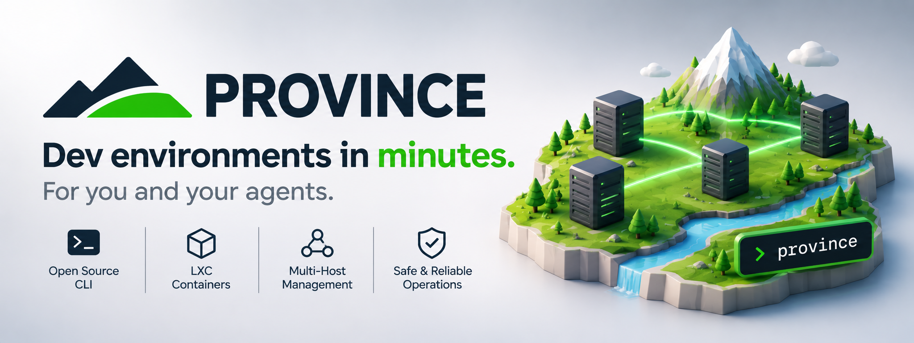

<p align="center"></p>

# Province

**Dev environments in minutes, for you and your agents.**

Province creates, sets up, moves and publishes development environments on your own Proxmox VE or Incus hosts, one command each, so you and your AI agents can go from idea to running pilot without clicking through a hypervisor UI.

Each environment is an LXC container on your tailnet: your user, your SSH keys, optional Docker, and a [recipe](docs/recipes.md) with the packages, tools and dotfiles you list. You reach it with `ssh dev@<name>` from anywhere on your tailnet.

**Create. Connect. Move. Destroy.**

## Contents

- [How it works](#how-it-works)
- [What you need](#what-you-need)
- [Getting started](#getting-started)
- [Proxmox host setup](#proxmox-host-setup)
- [Tailscale setup](#tailscale-setup)
- [Site config reference](#site-config-reference)
- [Recipes](#recipes)
- [Publishing an env (Tailscale Funnel)](#publishing-an-env-tailscale-funnel)
- [Commands](#commands)
- [Secrets](#secrets)
- [Recovery](#recovery)
- [Development](#development)

Guides: [Recipes](docs/recipes.md), [Incus hosts](docs/incus.md). Roadmap: [docs/todo.md](docs/todo.md). Agent instructions: [skills/province/SKILL.md](skills/province/SKILL.md).

## How it works

1. **Declare.** Province writes an OpenTofu config for the container, one state directory per environment (`bpg/proxmox` on Proxmox, `lxc/incus` on Incus), and shows you the plan.
2. **Create.** With `--apply`, tofu creates and starts the container.
3. **Bootstrap.** Province runs a script inside the new container through the host (`pct exec` on Proxmox, `incus exec` on Incus): your user and SSH keys, sudo, optional Docker, and Tailscale. From then on the env is on your tailnet.
4. **Set up.** Province applies the env's [recipe](docs/recipes.md): apt packages, tools at pinned versions (through mise), your dotfiles. `env provision` applies it again later.
5. **Use.** `ssh dev@<name>`. Optionally publish one port on the internet with `--expose` (Tailscale Funnel).

On Proxmox, `guest move` also moves any existing container or VM between standalone hosts, keeping its MAC address and so its IP.

Status: v1. Containers only (`--kind vm` is refused).

## What you need

**On the machine that runs province** (your laptop, or wherever your agents run):

| | Proxmox hosts | Incus hosts |
|---|---|---|
| `province` | yes | yes |
| [OpenTofu](https://opentofu.org/docs/intro/install/) (`tofu` on `PATH`) | yes | yes |
| A way to run commands on the host | `ssh` as root (or a user with passwordless sudo). [Why](#why-province-needs-a-shell-on-proxmox-hosts) | the `incus` client and a remote ([setup](docs/incus.md)) |
| A credential for the host's API | an API token per host, in an environment variable | none: the incus remote holds it |

**A Tailscale tailnet**, where every environment joins tagged (for example `tag:dev`): an auth key (`TS_AUTHKEY`) and, recommended, an API access token (`TS_API_KEY`). See [Tailscale setup](#tailscale-setup).

**Your site config**, a YAML file in your own private repo. Province reads its path from `--config` or `PROVINCE_CONFIG`.

## Getting started

### 1. Install

```
go install github.com/wellavelino/province/cmd/province@latest
```

Then install [OpenTofu](https://opentofu.org/docs/intro/install/) so `tofu` is on your `PATH`.

### 2. Prepare Tailscale

Create a tag for the environments and an auth key for it: steps 1 to 5 of [Tailscale setup](#tailscale-setup). Export the key:

```
export TS_AUTHKEY='tskey-auth-…'
export TS_API_KEY='tskey-api-…'     # optional: lets env destroy remove the tailnet node
```

### 3. Prepare your host

- **Proxmox:** download the Debian template, create an API token, and give province a shell on the host. All three are in [Proxmox host setup](#proxmox-host-setup).
- **Incus:** add the server as an incus remote (`incus remote add box https://box.example:8443 --token …`), or use the built-in `local` remote for Incus on this machine. See [Incus hosts](docs/incus.md).

### 4. Write a site config

Save this as `province.yaml` in a private repo and pick the `hosts` entry that matches your host:

```yaml
state_dir: ~/infra/province          # province keeps one directory per env here
user: dev                            # the sudo user created in each env
ssh_public_keys: [~/.ssh/id_ed25519.pub]
tailscale: { tag: "tag:dev" }

defaults:
  # Proxmox only: where containers go and what they start from.
  storage: local-lvm
  bridge: vmbr0
  template: local:vztmpl/debian-13-standard_13.0-1_amd64.tar.zst
  recipe: base

hosts:
  # A Proxmox host:
  - { name: pve1, node: pve1, endpoint: "https://pve1.example:8006", ssh: pve1 }
  # Or an Incus host (then the three Proxmox defaults above can go):
  # - { name: box, backend: incus, remote: box }

recipes:
  base:
    packages: [git, tmux, ripgrep]
```

```
export PROVINCE_CONFIG=~/infra/province.yaml
export PROXMOX_VE_API_TOKEN='province@pve!cli=…'   # Proxmox only
```

### 5. Create your first environment

```
province env create demo            # shows the tofu plan and the recipe; changes nothing
province env create demo --apply    # creates, bootstraps and applies the recipe (a few minutes)
ssh dev@demo
```

`province env list` shows every environment and whether it is running; `province env destroy demo --yes` removes it, including its tailnet node.

## Proxmox host setup

Do this once per Proxmox host.

### Template

```
pveam update
pveam download local debian-13-standard_13.0-1_amd64.tar.zst
```

Use the template you name in `defaults.template`.

### API token

Province reads the host through its API, and tofu creates containers with the same token. Create a role, a user and a token on the host:

```
pveum role add Province -privs "VM.Allocate VM.Audit VM.Config.CPU VM.Config.Disk VM.Config.Memory VM.Config.Network VM.Config.Options VM.PowerMgmt Datastore.AllocateSpace Datastore.Audit Sys.Audit SDN.Audit SDN.Use"
pveum user add province@pve
pveum acl modify / --users province@pve --roles Province
pveum user token add province@pve cli --privsep 0
```

The last command prints the token's secret once. The full token is `province@pve!cli=<secret>`. Export it as `PROXMOX_VE_API_TOKEN`, or, with several hosts, in a variable per host named by the host's `token_env`. Without `SDN.Audit` the API hides bridges, and province refuses with a hint.

Standalone (non-clustered) hosts each need their own token. A command needs only the tokens of the hosts it touches; `guest move` needs both.

### Shell access to the host

#### Why province needs a shell on Proxmox hosts

Province uses the API wherever it can. A few things the Proxmox API cannot do with a token, so province runs them on the host over `ssh`:

| What | Run on the host |
|---|---|
| Bootstrap, recipes, Funnel, `tailscale logout` in the guest | `pct exec`. The API has no call that runs a command in a container, and a new guest is not on your tailnet yet. |
| `--docker` (keyctl) and `tailscale.tun: device` (`/dev/net/tun`) | `pct set`. Proxmox lets only `root@pam` change these. |
| `guest move` and `guest prune` | `vzdump`, `zstd`, `df`, `pct restore` / `qmrestore`, `pct destroy`. Not in the API. |

These commands need root: log in as root, or as a user with passwordless sudo and `sudo: true` on the host in the site config. Province uses your system `ssh`, so `~/.ssh/config` aliases and settings apply. Incus hosts need none of this; province uses the `incus` client instead.

#### Option A (recommended): Tailscale SSH

Put the Proxmox host on your tailnet and let your tailnet policy decide who may log in. No SSH keys to copy, and the host is reachable from anywhere you are.

1. On the host: install Tailscale and run `tailscale up --ssh --advertise-tags=tag:pve`.
2. In the tailnet policy, own the tag and let yourself in as root:
   ```json
   "tagOwners": { "tag:pve": ["autogroup:admin"] },
   "ssh": [
     { "action": "accept", "src": ["autogroup:admin"], "dst": ["tag:pve"], "users": ["root"] }
   ]
   ```
   Use `accept`, not `check`: a `check` rule opens a browser prompt that province and agents cannot answer, so the command would hang.
3. In the site config, set `ssh:` to the host's MagicDNS name, for example `ssh: pve1`.

#### Option B: a plain SSH key

Add your public key to `/root/.ssh/authorized_keys` on the host (or to a sudo user's, with `sudo: true`), and check that `ssh root@pve1 true` works without a password prompt. Set `ssh:` to the destination you used.

## Tailscale setup

Every environment joins your tailnet tagged (`tag:dev` below; use your own tag name) and, by default, with Tailscale SSH on, so your tailnet policy, not keys on the guest, decides who logs in. The user's `authorized_keys` is still installed as a fallback for plain SSH on the LAN. Do these once, in order, in the admin console:

1. **Create the tag.** Access controls → Tags → Create tag `tag:dev`, owned by admins. In the JSON policy file:
   ```json
   "tagOwners": { "tag:dev": ["autogroup:admin"] }
   ```
2. **Let your devices reach the guests.** The default policy (allow all) already does this. If you replaced it, add a grant (or the equivalent ACL rule):
   ```json
   "grants": [
     { "src": ["autogroup:member"], "dst": ["tag:dev"], "ip": ["*"] }
   ]
   ```
   Allow-all also lets the guests reach your devices; replace it with explicit grants if you want them isolated (see [Security](#security-of-published-envs)).
3. **Allow Tailscale SSH into the guests.**
   ```json
   "ssh": [
     { "action": "check", "src": ["autogroup:admin"], "dst": ["tag:dev"], "users": ["autogroup:nonroot", "root"] }
   ]
   ```
   `check` asks you to re-authenticate in the browser before a session (then remembers it for the check period, 12 h by default); `accept` lets the connection in with no prompt. `check` is safer for people; an unattended agent cannot answer the prompt, so use `accept` for a source that must log in without you (scope it tightly). `autogroup:nonroot` allows any non-root local user, such as the `user` from the site config.
4. **Auth key.** Settings → Keys → Generate auth key: reusable, pre-approved (matters only if device approval is on), not ephemeral, tags `tag:dev`. Export it as `TS_AUTHKEY`. It expires (at most 90 days); generate a new one when it does.
5. **API access token.** Settings → Keys → Generate access token. Export it as `TS_API_KEY`; `env destroy` uses it to delete the guest's node, because tagged nodes do not expire and would otherwise stay listed (offline). It expires too. With it set, `env create --apply` looks the new node up after bootstrap (its name, the tag and the address the guest reported must all agree) and records its ID as `tailscale_device_id` in `province.json`; `env destroy` deletes that device by ID. For an env without a recorded ID, destroy deletes the device of the env's name and tag only if it holds the env's recorded `tailscale_ip`, never a namesake, and skips envs that never joined. When it deletes nothing for a joined env, it warns `NOT revoked`: delete the node in the admin console. `TS_TAILNET` defaults to `-`, the key's own tailnet.
6. **Verify** after `province env create demo --apply`:
   ```
   tailscale status | grep demo     # listed, tagged tag:dev
   ssh dev@demo                     # Tailscale SSH (MagicDNS name); a check rule opens a browser prompt
   ```
   Tailscale SSH is served by `tailscaled` itself, so it works with `tun: userspace`. Without MagicDNS use the `tailscale_ip` from `province env show demo`.

## Site config reference

Keep it in your own private repo; pass it with `--config` or `PROVINCE_CONFIG`. Unknown keys are rejected, so a typo fails loudly. A full example, with two standalone Proxmox hosts and one Incus host:

```yaml
state_dir: ~/infra/province            # one tofu dir per env; commit it to a private repo if you like
user: dev                              # sudo user created in each env (default: your OS user)
ssh_public_keys: [~/.ssh/id_ed25519.pub]
tailscale: { tag: "tag:dev", tun: userspace, ssh: true }
  # tun: userspace (default) | device (/dev/net/tun)
  # ssh: Tailscale SSH in each guest (default true); authorized_keys is installed either way
vmid_start: 100                        # Proxmox: env create picks the lowest VMID >= this that is free on every Proxmox host
guest_locales: [en_US.UTF-8]           # generated in each guest so locales your ssh client forwards work (default)
defaults:
  host: pve1                           # used without --host; optional with a single host
  storage: local-lvm                   # Proxmox: storage for the root disk
  bridge: vmbr0                        # Proxmox: network bridge
  template: local:vztmpl/debian-13-standard_13.0-1_amd64.tar.zst   # Proxmox
  cpu: 2
  ram: 2048    # MiB
  disk: 16     # GiB
  recipe: base # applied after bootstrap when --recipe is not given (none: no recipe)
hosts:
  - { name: pve1, node: pve1, endpoint: "https://pve1.example:8006", insecure: true, ssh: pve1, sudo: false,
      dump_dir: /var/lib/vz/dump, token_env: PROVINCE_TOKEN_PVE1 }
  - { name: pve2, node: pve2, endpoint: "https://pve2.example:8006", ssh: admin@pve2.example, sudo: true,
      token_env: PROVINCE_TOKEN_PVE2 }
  - { name: box, backend: incus, remote: box }   # see docs/incus.md
recipes:  # see docs/recipes.md
  base:
    packages: [git, tmux, ripgrep]
    dotfiles: https://github.com/you/dotfiles
  go:
    include: [base]
    tools: { go: "1.24", golangci-lint: latest }
```

```
export PROVINCE_TOKEN_PVE1='province@pve!cli=…'   # from pve1
export PROVINCE_TOKEN_PVE2='province@pve!cli=…'   # from pve2
```

**Proxmox host fields:** `name` (what you pass to `--host`), `node` (the Proxmox node name), `endpoint` (the API URL, https), `ssh` (destination for the [shell access](#shell-access-to-the-host)), `sudo` (true when `ssh` is not root), `insecure` (skip TLS verification for this host only), `dump_dir` (where `guest move` puts the dump on the target, default `/var/lib/vz/dump`), `token_env` (the variable holding this host's token, default `PROXMOX_VE_API_TOKEN`). tofu gets the token as `PROXMOX_VE_API_TOKEN` in its environment, never as an argument.

**Incus host fields:** `backend: incus`, `remote` (required), `project`, `storage_pool`, `network`, `image`. See [Incus hosts](docs/incus.md).

A host without `backend` is a Proxmox host. The three Proxmox defaults (`storage`, `bridge`, `template`) are required only when the config has a Proxmox host.

## Recipes

A recipe lists what an environment has inside, and province installs it after the bootstrap. No shell to write:

```yaml
recipes:
  go:
    include: [base]                                # apply recipe base first
    packages: [make]                               # apt packages
    tools: { go: "1.24", golangci-lint: latest }   # installed with mise, for your user
    dotfiles: https://github.com/you/dotfiles      # cloned to ~/.dotfiles; its install.sh runs
    run: ["echo anything else, as root"]           # escape hatch
```

`env create --recipe go` shows the recipe in the plan and applies it with `--apply`; `env provision <name>` applies it again. Full guide, including running Ansible or Nix from a recipe: [docs/recipes.md](docs/recipes.md).

## Publishing an env (Tailscale Funnel)

Tailscale Funnel publishes one port of a guest on the public internet as `https://<name>.<tailnet>.ts.net/` (443, TLS from Tailscale) → `localhost:<port>` in the guest. Anyone with the URL can reach it. Once, in the admin console:

1. **MagicDNS and HTTPS certificates.** DNS page → enable MagicDNS, then HTTPS Certificates.
2. **Allow Funnel for the tag.** In the policy file:
   ```json
   "nodeAttrs": [
     { "target": ["tag:dev"], "attr": ["funnel"] }
   ]
   ```
   Without it (or without HTTPS) `env expose` refuses (exit 2) and prints this line for your tag.

Then per env:

3. **Publish.** Either at creation, `province env create demo --expose 3000 --apply` (recorded as `expose_port` in `province.json`, published right after the bootstrap; a plan without `--apply` only records it), or later `province env expose demo --port 3000 --yes`. The guest must be running. Province checks the node's Funnel capabilities with `tailscale status --json`, then runs `tailscale funnel --bg 3000` in the guest (idempotent; a new port replaces the old one).
4. **The URL** is the guest's MagicDNS name: `public_url` in `env show` / `env list` (for example `https://demo.tail0000.ts.net/`). The first publish of a name can take a few minutes to resolve publicly.
5. **Unpublish.** `province env unexpose demo --yes` runs `tailscale serve --https=443 off` in the guest (everything served on 443 there stops) and clears the record. `env destroy` logs the node out, which ends Funnel too.

### Security of published envs

A published app is reachable by anyone, so assume it can be compromised and keep it from reaching anything else. Province treats what a guest reports as untrusted: `env expose` records the public URL only when the node's MagicDNS name is `<env>.<tailnet>.ts.net` (or `<env>-<n>.…`, Tailscale's suffix for a taken name) and refuses otherwise, and human (non-`--json`) output escapes control characters in every string it prints. The allow-all default policy lets every node, including `tag:dev`, reach every other node; for exposed envs, replace it with grants where your devices reach the guests and `tag:dev` reaches nothing:

```json
{
  "tagOwners": { "tag:dev": ["autogroup:admin"] },
  "grants": [
    { "src": ["autogroup:member"], "dst": ["tag:dev"], "ip": ["*"] }
  ],
  "ssh": [
    { "action": "check", "src": ["autogroup:admin"], "dst": ["tag:dev"], "users": ["autogroup:nonroot", "root"] }
  ],
  "nodeAttrs": [
    { "target": ["tag:dev"], "attr": ["funnel"] }
  ]
}
```

No grant has `tag:dev` as its `src`, so a guest cannot open connections to your devices or your hosts over the tailnet (replies to your own connections still flow). If envs must talk to each other, add only `{ "src": ["tag:dev"], "dst": ["tag:dev"], "ip": ["*"] }`. This covers the tailnet only: the guest also sits on the LAN through its bridge or network and can reach your hosts' LAN addresses there. Isolating that needs a separate VLAN or firewall, which province does not set up.

## Commands

Every command takes `--json`: stdout then holds exactly one JSON document, the result or `{"error":"…","code":"refused|preflight|failed"}`. Exit codes: `0` ok, `2` refused or preflight failed (nothing changed), `1` failed.

| Command | What it does |
|---|---|
| `env create <name> [--host h] [--cpu n] [--ram MiB] [--disk GiB] [--docker] [--expose port] [--recipe r]` | Checks the host (Proxmox: template, bridge and storage; Incus: the remote and its pool), writes `<state_dir>/<name>/main.tf.json` and shows the `tofu plan` and the resolved recipe. Changes nothing. Flags are remembered for the `--apply` run. |
| `env create <name> --apply` | Applies, then on Proxmox (if needed) sets keyctl / `/dev/net/tun` over SSH and reboots, then bootstraps: user, keys, sudo, optional Docker, Tailscale. With an `expose_port`, then publishes it ([Funnel](#publishing-an-env-tailscale-funnel)). Then applies the [recipe](docs/recipes.md). Prints `ssh <user>@<name>`. |
| `env provision <name> [--recipe r]` | Applies the env's recipe again, or switches it to recipe `r`. The env must be bootstrapped and running. |
| `env list` | All environments with recorded and live status (one API call, or one `incus query`, per host; an unreachable host, or one whose token variable is unset, shows `unknown`). |
| `env show <name>` | One environment, live status, the ssh line and the public URL if published. |
| `env expose <name> --port p --yes` | Publishes guest port `p` on the internet through Tailscale Funnel and records `expose_port` and `public_url`. Refuses without `--yes`, when the guest is not running, or when the tailnet does not allow Funnel for the tag. |
| `env unexpose <name> --yes` | Turns Funnel off in the guest and clears the record. |
| `env destroy <name> --yes` | `tailscale logout` in the guest, deletes the env's tailnet node by its recorded device ID (with `TS_API_KEY`; see [Tailscale setup](#tailscale-setup)), `tofu destroy`, removes the state dir. |
| `guest move <vmid> --from h1 --to h2 [--to-vmid n] [--storage s] [--start] --yes` | Proxmox hosts only. Moves any container or VM between standalone hosts. See [Moving guests](#moving-guests-proxmox). |
| `guest prune <vmid> --host h [--force] --yes` | Proxmox hosts only. Deletes the stopped copy a move left behind (`pct destroy <vmid> --purge` / `qm destroy <vmid> --purge`). Refuses (exit 2, nothing changed) unless the guest is stopped, has `onboot=0`, has no `protection=1` or lock, is not a province env (use `env destroy`), and a guest with the same name exists on another configured host (the moved-copy check; `--force` skips only that check). |

### Moving guests (Proxmox)

`guest move` first runs a read-only preflight:

- the target VMID is free on the target (if it is taken, the refusal suggests a `--to-vmid` free on every host);
- the bridges and storage exist on the target;
- the target storage has room for the full allocated disk size;
- `dump_dir` has room for the dump, estimated from a running container's used bytes (used × 1.1 + 1 GiB), or the allocated size for a VM or a stopped container. On a `dir` or `zfspool` target storage, which usually shares the dump's filesystem, it needs room for both.

Then it shuts down the source, streams `vzdump --stdout --mode stop --compress zstd` through your machine into `dump_dir` on the target, checks it with `zstd -t`, restores with the same VMID or `--to-vmid` (MAC kept either way, so DHCP keeps the IP), sets `onboot=0` on the source and removes the dump. The target starts only with `--start`, and only after the source is pinned to `onboot=0`.

The moved guest keeps the `onboot` value it had in the archive; the source is kept, stopped with `onboot=0`, as a rollback. Once you are happy with the moved copy, remove the source with `province guest prune <vmid> --host <source> --yes`.

## Secrets

Secrets come only from environment variables: the Proxmox tokens, `TS_AUTHKEY` and `TS_API_KEY`. Province removes each one from its own environment once read, so child processes (ssh, tofu, installers) never inherit it; tofu gets its host's token explicitly. Secrets never appear in arguments, generated files, tofu state or output: a redactor scrubs every line province prints. The Tailscale auth key reaches a guest only on the bootstrap script's stdin.

Incus hosts add no secret: the incus remote's client certificate lives in your Incus client config (`~/.config/incus`), which province never reads.

## Recovery

- **Recipe failed**: the env is bootstrapped and on the tailnet; the command exits 1 and names the failing step. Fix the recipe and run `province env provision <name>`.
- **Bootstrap failed** (`status: bootstrap_failed`): the container and its state are kept. Fix the cause and re-run `province env create <name> --apply`; apply is a no-op if nothing changed and the bootstrap is idempotent.
- **tofu apply failed**: fix the cause (often a token privilege) and re-run `province env create <name> --apply`.
- **Destroy failed**: the state dir is kept; re-run `province env destroy <name> --yes`.
- **Another guest at the env's VMID**: before `expose`, `unexpose`, `provision`, `destroy` or a re-run of `create --apply`, province checks that the guest at the env's VMID is an LXC container named after the env (on Incus: an instance whose `user.province.env` is the env's name). If not, it refuses (exit 2) and names the guest it found; `show` and `list` report the env as `unknown` with that error. If you renamed the env's container, rename it back (`pct set <vmid> --hostname <env>`); if it is gone, remove the env's state dir by hand. A new env never gets a VMID that another env in the state dir records, even when that env's guest is gone.
- **After a move**: the source copy stays (stopped, `onboot=0`) until you run `province guest prune <vmid> --host <source> --yes`; to roll back instead, stop the new copy and `pct start <vmid>` / `qm start <vmid>` the source.
- **Move failed after the source stopped**: nothing runs on the target; the error names the command to start the source again (`pct start <vmid>` or `qm start <vmid>` on the source host). If the restore failed, the verified dump is kept in `dump_dir` on the target and the error gives its path: fix the cause (often storage), check `pct list` / `qm list` for a partial guest, then restore by hand (`pct restore <vmid> <dump> --storage <s>` or `qmrestore <dump> <vmid> --storage <s>`) without a second transfer, or delete the dump. If only `onboot=0` on the source failed, the target restore succeeded: set it by hand (`pct set <vmid> --onboot 0`) before starting the target; do not re-run the move.
- **`--start` failed after the move**: the move itself is complete (the copy is restored on the target, the source is stopped with `onboot=0`, the dump is removed), so do not re-run it. The command exits 1, the error names the command to start the copy (`pct start <vmid>` / `qm start <vmid>` on the target host), and a province env is re-homed to the target exactly as after a successful move.
- **Moved a province env**: after a `guest move` of an env's guest (successful, or failed only at `--start`), province updates its `province.json` and `main.tf.json` (new host, node, VMID, storage) and re-points the tofu state with the target host's token (`tofu state rm proxmox_virtual_environment_container.env`, then `tofu import proxmox_virtual_environment_container.env <node>/<vmid>`). If that fails, the move still stands (the guest is safe), the env is marked `tofu_out_of_sync` and the output lists the exact commands still to run; `env destroy` refuses until they are done.

## Development

`bash .claude/verify.sh` runs gofmt, vet, build, `go mod tidy -diff`, race tests, shellcheck and staticcheck (when installed). Unit tests use fakes only; none talk to a real host.

`bash scripts/tofu-validate.sh` runs `tofu init` and `tofu validate` on every generated config in `internal/tfgen/testdata` (the golden files the tfgen tests compare against), so the real `lxc/incus` and `bpg/proxmox` providers check each attribute. It needs `tofu` and access to the OpenTofu registry, but no credentials or host. After changing a generator, refresh the golden files with `go test ./internal/tfgen -update`, then run it.

Two more tests run against real systems:

- `go test -tags integration -run TestRecipeInDebianContainer ./internal/bootstrap/` applies a real recipe twice in a Debian 13 container (needs Docker and network access).
- `bash scripts/e2e-incus.sh` drives the real binary against a real Incus server through its `local` remote. Without `TS_AUTHKEY` it stops after the plan; with it, it runs the full create, provision and destroy cycle.

CI (`.github/workflows/ci.yml`) runs all four on every push and pull request.

Design history: [docs/brief.md](docs/brief.md) and [docs/plan-v1.md](docs/plan-v1.md), the notes the first version was built from.

What comes next, what is deliberately left out, and the rule new features are held to: [docs/todo.md](docs/todo.md).

License: [MPL-2.0](LICENSE).
